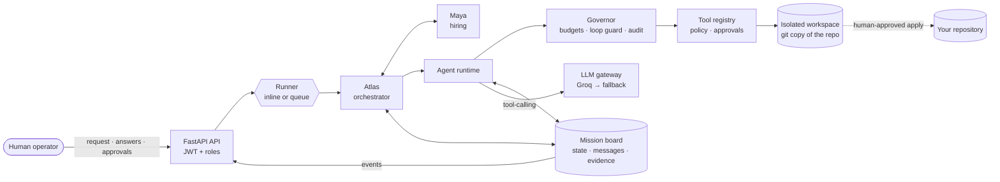

# DevPilot — The Mystic Mikado's Autonomous AI Engineering Guild

> **PECathon 2026 · PS-001** — *Plan like a Shogun. Build like a Samurai. Test like a Sentinel. Adapt until the mission is complete.*

DevPilot turns a natural-language software request into a **working, tested, reviewed and human-approved change** to an existing repository. A guild of 16 specialised AI agents does the work: **Atlas** orchestrates, **Maya** hires exactly the specialists each mission needs — at the start and while it runs — and nothing counts as done without evidence from real test runs.

| | |
|---|---|
| **Full project context** (problem, USP, teams, flow, coverage) | [docs/PROJECT_CONTEXT.md](docs/PROJECT_CONTEXT.md) |
| **Detailed architecture** | [docs/ARCHITECTURE.md](docs/ARCHITECTURE.md) |
| **End-to-end run log** (live, on Groq) | [docs/runs/2026-10-30-live-billing-fix/](docs/runs/2026-10-30-live-billing-fix/report.md) |
| **Evaluation scenarios** | [missions/](missions/README.md) |
| **Backend source** | [backend_main/](backend_main) |

---

## Architecture



### The guild — agent responsibilities

| Team (PS section) | Agent | Responsibility |
|---|---|---|
| **Executive** (E) | **Atlas** | Runs the mission loop: dispatches ready tasks in parallel, reads results, decides continue / retry / reassign / re-plan / clarify / escalate / stop / complete; enforces the required checks; completes only on verified evidence |
| | **Maya** | Hires specialists by deterministic skill scoring; escalates repeated failures to a different specialist; writes each hire's mandate; releases the task force |
| **Shogun's Council** (A) | **Kenji** | Request → objectives and testable acceptance criteria; asks the human when genuinely ambiguous |
| | **Hana** | Codebase reconnaissance: layout, conventions, risks, test baseline |
| | **Ryo** | Task graph with dependencies, linked to criteria |
| **Samurai Forge** (B) | **Takeshi** · **Yuki** | Backend / frontend implementation in the project's style |
| | **Daichi** | Debugger — called in when a fix keeps failing |
| | **Sora** | Refactoring and style, without changing behaviour |
| **Sentinel Dojo** (C) | **Aiko** | Runs tests, lint, builds; reports failures with evidence |
| | **Riku** | Writes tests; sets up a test runner when a project has none |
| | **Mei** | Independent verifier — checks every criterion against evidence |
| **Shadow Council** (D) | **Haruto** | Code review: correctness, readability, consistency, regressions |
| | **Kaito** | Security inspection: secrets, injection, unsafe operations |
| | **Emi** | Arbiter — settles developer-vs-reviewer disputes on evidence, or escalates |
| **Support** | **Scribe** | Narrative report (Atlas always writes the evidence report) |

Reviewers, the verifier, the inspector and the arbiter hold **no code-editing tools**, and an author can never review or verify its own change — separation of duties is enforced by tool grants and hiring rules, not prompts.

### Communication, orchestration and shared state

- **Shared mission state** — one mission document per mission holds objectives, acceptance criteria, the task graph, findings, decisions, open issues, hires and evidence references. Rules are enforced in code (acyclic dependencies, allowed transitions, criteria met only with evidence). Updates use optimistic concurrency, so agents working in parallel never overwrite each other.
- **Inter-agent communication** — agents send messages to agents, teams (`@forge`, `@sentinel`, `@shadow`) or everyone; record and dispute findings; raise questions; all through governed, audited tools. New messages arrive in each agent's briefing.
- **Orchestration** — Atlas is a rule-based decision loop over the task graph (not a pipeline): failing tests, review findings, disputes and unmet criteria create repair, test-authoring or arbitration tasks; any code change re-runs stale checks; repeated failure escalates to a specialist, then to a human. Every decision is recorded with its reason.
- **Events** — every change is stored, sequenced and streamed live over WebSocket.

Details: [docs/ARCHITECTURE.md](docs/ARCHITECTURE.md).

---

## Setup

Requirements: **Python 3.12+**, git, Groq API keys (free tier works; throughput scales with the number of keys from separate accounts — ~15–20 for ~1.5-minute missions). Docker optional.

```bash
cd backend_main
python -m venv .venv
```

Activate it (`.venv\Scripts\activate` on Windows, `source .venv/bin/activate` elsewhere), then:

```bash
pip install -r requirements-dev.txt
cp .env.example .env
```

Edit `backend_main/.env`:

```env
GROQ_API_KEYS=gsk_key1,gsk_key2,...
BOOTSTRAP_ADMIN_PASSWORD=choose-a-long-password      # creates user "admin" on first start
JWT_SECRET=a-random-string-of-at-least-32-characters
```

Run (single process, in-memory storage — nothing else to install):

```bash
python -m uvicorn app.main:app --port 8000
```

Open **http://localhost:8000/docs**, click **Authorize** and sign in as `admin`. Then:

1. `POST /api/v1/missions` — `{"request": "Fix the pagination bug", "repo_path": "D:/path/to/repo", "start": true}`
2. Follow `GET /api/v1/missions/{id}/snapshot` or the WebSocket `ws://localhost:8000/api/v1/realtime/missions/{id}?token=<token>`
3. Answer questions: `POST /missions/{id}/issues/{issue_id}/resolve`; approve actions: `POST /approvals/{id}/respond`
4. Review `GET /missions/{id}/patch`, then `POST /missions/{id}/apply` and approve it

**Production-style** (API replicas + scalable workers + MongoDB + Redis):

```bash
docker compose up --build --scale worker=3
```

**Tests:** `python -m pytest` (176 tests; set `DEVPILOT_TEST_REDIS_URL` / `DEVPILOT_TEST_MONGO_URL` to include real-server tests).
**Evaluation:** `python -m app.evaluation --mode both --out ../docs/runs/my-eval`.

### Configuration

All settings are environment variables (or `backend_main/.env`), documented in [.env.example](backend_main/.env.example):

| Group | Key settings |
|---|---|
| LLM | `GROQ_API_KEYS`, `GEMINI_API_KEYS`, `LLM_MODEL_SMART`, `LLM_MODEL_FAST`, `LLM_MAX_REQUEST_TOKENS` |
| Backends | `STORAGE_BACKEND` (memory/mongo), `BUS_BACKEND` (memory/redis), `EXECUTION_MODE` (inline/queue) |
| Security | `AUTH_ENABLED`, `JWT_SECRET`, `BOOTSTRAP_ADMIN_*`, rate limits, `CORS_ORIGINS` |
| Bounded autonomy | `MISSION_MAX_TOOL_CALLS`, `MISSION_MAX_LLM_TOKENS`, `MISSION_MAX_WALL_CLOCK_S`, `REPAIR_MAX_ATTEMPTS`, `ESCALATE_AFTER_FAILURES` |
| Sandbox | `DATA_DIR`, `COMMAND_TIMEOUT_S`, `ALLOWED_REPO_ROOTS` |

---

## Tools and execution boundaries

**21 tools**, each granted per agent:

| Group | Tools |
|---|---|
| Files | `read_file`, `write_file`, `edit_file`, `list_dir`, `find_files` |
| Search | `search_text` |
| Commands | `run_command`, `run_tests` (auto-detects pytest / npm / go / cargo; results stored as evidence) |
| Git (read-only) | `git_status`, `git_diff`, `git_log` |
| Security | `secret_scan`, `static_scan` |
| Coordination | `mission_state`, `read_inbox`, `send_message`, `record_finding`, `update_finding`, `raise_issue`, `list_evidence`, `verify_criterion` |

**Boundaries:**

- Agents work on an **isolated git copy** of the repository; every path is resolved and must stay inside it.
- Commands run **without a shell** (no pipes, chaining or redirection), with secret-looking environment variables removed, a timeout and bounded output.
- Every action is classified:
  - **GREEN** — runs: reads, searches, tests, linters, builds, read-only git.
  - **AMBER** — needs human approval: package installs, inline code (`python -c`), commits, reading `.env`/keys, CI changes, unknown commands.
  - **RED** — refused: shells, destructive and system commands, network tools, `git push/reset/clean`, publishing, writing `.git`.
- **Budgets** on tool calls, tokens and time; a **loop guard** refuses repeating a failing call with nothing changed; attempt and repair limits; escalation to a human.

---

## Human approval mechanism

- **AMBER actions** pause the agent and raise an approval (shown in the control-room modal; `GET /missions/{id}/approvals`). An `approver` decides via `POST /approvals/{id}/respond`. No answer before `APPROVAL_TIMEOUT_S` counts as **denied**. Decisions are stored and decided exactly once, and work across API replicas and workers.
- **Ambiguous requests** pause the mission (`awaiting_human`); answering the question resumes it with all work kept.
- **Applying a change to the real repository** always needs approval: `POST /missions/{id}/apply` → approver reviews the diff and approves → DevPilot checks every touched file still matches the mission's baseline (otherwise writes nothing), backs up the originals and writes the change **without committing or pushing**.
- **Roles:** `viewer` (watch) < `operator` (run missions, answer questions, request apply) < `approver` (approve actions and applies) < `admin` (users). Every human action is recorded under the user's name.

---

## Security assumptions

- The host running workers is trusted; missions are given repositories the operator chose. Isolation is per-process (a copy of the repo, path jail, no shell) — not a container per mission.
- Test and build commands execute the project's own code; a malicious repository could act with the worker's OS privileges.
- LLM providers receive the repository content agents read.
- The API requires authentication (JWT, scrypt-hashed passwords, roles, rate limits on login and requests, security headers). In production the server refuses to start without auth, a JWT secret, explicit CORS origins, or with auto-approvals enabled. `/metrics` is unauthenticated and should only be reachable by your monitoring.

## Known limitations

- The control-room frontend (from Mycel) has not yet been adapted to DevPilot; the API and Swagger UI are the interface today.
- Process-level sandbox; stopping a mission is cooperative (a running test command finishes first).
- Workers need each target project's toolchain (the image includes Python).
- The Gemini fallback has not been verified live; free-tier Groq limits (~8k tokens per request and per minute per account) bound throughput.
- No persistent memory across missions yet; tool schemas use ~3k tokens per agent request.
- The full live guild-vs-baseline evaluation is still to be run and published.

---

## Repository layout

| Path | Contents |
|---|---|
| `backend_main/` | DevPilot backend — FastAPI, agents, orchestration, tools, safety, workers |
| `missions/` | Six evaluation scenarios with hidden acceptance checks |
| `docs/` | Project context, architecture, build phases, run logs |
| `frontend/` | Control-room frontend inherited from Mycel (to be adapted) |
| `backend/`, `jarvis/` | Earlier projects whose code was ported (not used at runtime) |
