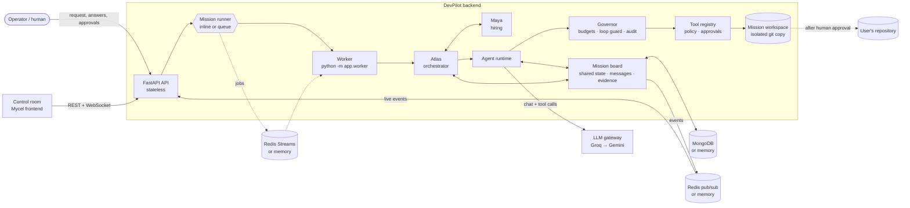
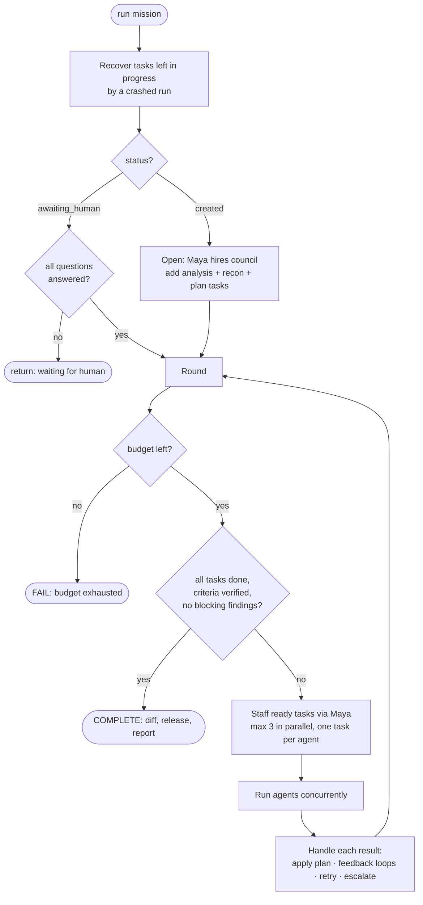
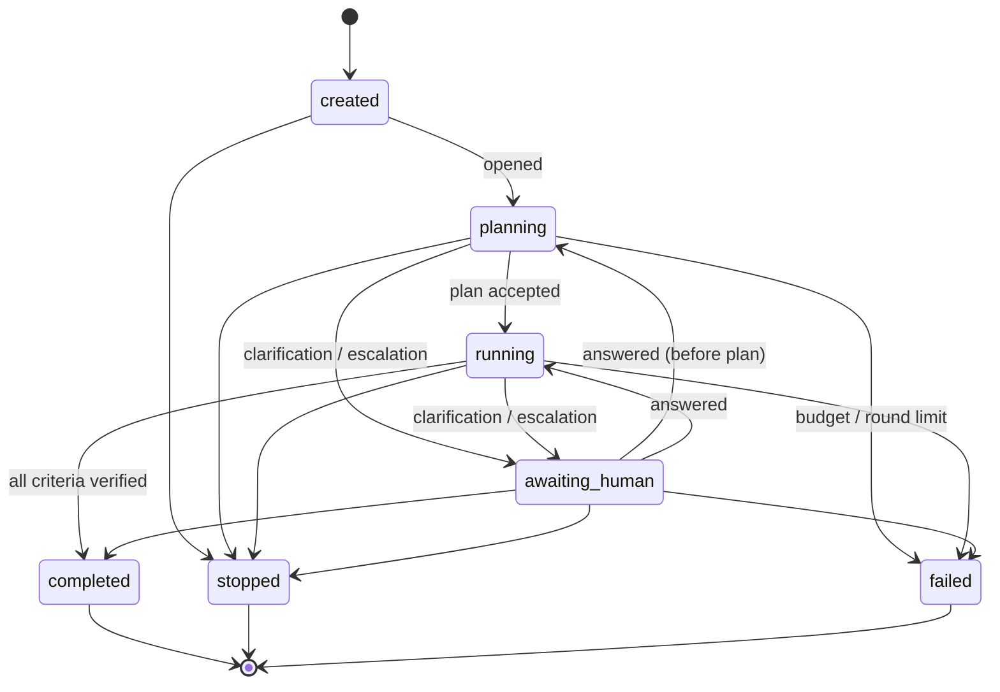
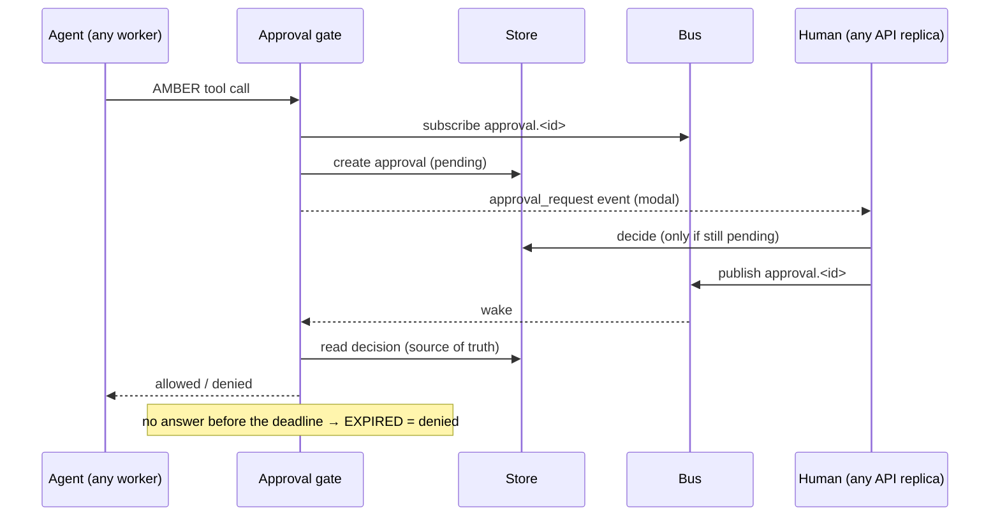
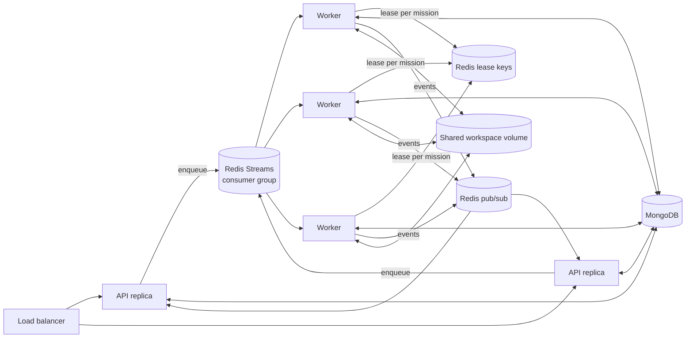

# DevPilot — Architecture

> PS-001 · *Plan like a Shogun. Build like a Samurai. Test like a Sentinel. Adapt until the mission is complete.*

DevPilot turns a natural-language request ("fix the pagination bug", "add discount codes") into a **working, tested, reviewed and human-approved change** to an existing repository. A guild of 16 specialised AI agents does the work; **Atlas** orchestrates and **Maya** hires the specialists each mission needs, while it runs.

This document describes the system as built in [`backend_main/`](../backend_main). Code links point to the implementation.

---

## Contents

1. [Design principles](#1-design-principles)
2. [System overview](#2-system-overview)
3. [Code layout and layering](#3-code-layout-and-layering)
4. [The guild: agents, teams, tools and skills](#4-the-guild)
5. [Maya: dynamic hiring](#5-maya-dynamic-hiring)
6. [Atlas: the orchestration loop](#6-atlas-the-orchestration-loop)
7. [Agent runtime](#7-agent-runtime)
8. [Shared mission state and agent communication](#8-shared-mission-state-and-agent-communication)
9. [Tools and the execution sandbox](#9-tools-and-the-execution-sandbox)
10. [Governance: bounded autonomy and human oversight](#10-governance)
11. [Evidence, verification and the mission report](#11-evidence-verification-and-the-report)
12. [Applying the change to the real repository](#12-applying-the-change)
13. [LLM gateway and model handling](#13-llm-gateway)
14. [Events, realtime stream and the control room](#14-events-and-realtime)
15. [Persistence](#15-persistence)
16. [Execution model, scaling and failure recovery](#16-execution-model-and-scaling)
17. [API reference](#17-api-reference)
18. [Configuration](#18-configuration)
19. [Evaluation](#19-evaluation)
20. [Testing strategy](#20-testing-strategy)
21. [Security model and assumptions](#21-security-model)
22. [Known limitations and roadmap](#22-known-limitations-and-roadmap)
23. [Lineage: what came from Mycel and Jarvis](#23-lineage)

---

## 1. Design principles

| Principle | What it means in the code |
|---|---|
| **Coordination, not a pipeline** | No fixed sequence of LLM calls. Atlas runs a decision loop over a task graph; agents exchange findings and evidence through a shared board; results change what happens next. |
| **Evidence over claims** | A test result is a stored record of a real run, not an agent's sentence. An acceptance criterion can only be marked *met* with cited, passing evidence; a mission can only complete when every criterion is met. |
| **The registry decides, not the model** | Agents act only through tools. Every call is checked against the agent's tool grant, the action policy, budgets and the loop guard before it runs — whatever the model asks for. |
| **Bounded autonomy** | Hard limits on rounds, attempts, repair cycles, tokens, tool calls and wall-clock time. Repeated failure escalates to a different specialist, then to a human — never an endless loop. |
| **Humans hold the consequential actions** | Risky commands need approval; touching the real repository always does. Ambiguity pauses the mission for the human instead of guessing. |
| **Safe by construction** | Agents work on an isolated copy of the repository, commands run without a shell and with secrets removed, and tool grants enforce separation of duties (reviewers cannot edit code). |
| **One codebase, any scale** | Every external system sits behind an interface with an in-memory implementation (laptop, tests) and a production one (MongoDB, Redis, real LLMs). The same code runs as one process or as API replicas plus workers. |

---

## 2. System overview



**A mission, end to end:**

1. The operator posts a request and a repository path. DevPilot copies the repository into an isolated workspace with a baseline git commit.
2. Atlas opens the mission: Maya hires the planning council; requirements analysis and codebase reconnaissance run **in parallel**, then the planner produces a task graph.
3. Atlas adds the checks the problem statement requires (tests, review, security, independent verification), then dispatches ready tasks — up to three at once — hiring specialists as each task needs them.
4. Results feed back: failing tests, review findings and unmet criteria create repair tasks; repeated failure brings in a different specialist; ambiguity or exhausted limits go to a human.
5. When every criterion is verified with evidence, Atlas completes the mission and writes an evidence report.
6. A human reviews the diff and approves; only then is the change written into the real repository (uncommitted, for the human to review).

---

## 3. Code layout and layering

```
backend_main/app/
├── main.py                  app factory, lifespan
├── worker.py                mission worker process
├── container.py             composition root — builds every dependency once
├── core/                    settings, logging, error model, ids
├── domain/                  pure models: mission, agents, hiring, skills, governance, events
├── services/                use cases: board, orchestrator, hiring, governance, approvals, apply, runner, report, planning
├── agents/                  guild definitions, runtime loop, prompts
├── tools/                   registry + built-in tools (files, search, commands, git, security scans, board)
├── security/                action policy, workspace sandbox, process runner
├── infrastructure/          llm/ (providers, gateway) · bus/ · storage/ · jobs/ — each with memory + production backends
├── evaluation/              scenario harness, single-agent baseline, run-log export
└── api/                     HTTP + WebSocket routes, middleware, dependencies
```

**Dependency rule:** `api → services → domain`. Infrastructure implements interfaces (`Protocol`s) declared beside the domain. Domain code imports no web framework, database, broker or LLM SDK. Only [`container.py`](../backend_main/app/container.py) constructs infrastructure, chosen from settings; routes receive it through FastAPI dependencies and tests replace it.

| Area | Key files |
|---|---|
| Domain | [mission.py](../backend_main/app/domain/mission.py) · [agents.py](../backend_main/app/domain/agents.py) · [hiring.py](../backend_main/app/domain/hiring.py) · [skills.py](../backend_main/app/domain/skills.py) · [governance.py](../backend_main/app/domain/governance.py) · [events.py](../backend_main/app/domain/events.py) |
| Orchestration | [orchestrator.py](../backend_main/app/services/orchestrator.py) · [planning.py](../backend_main/app/services/planning.py) · [hiring.py](../backend_main/app/services/hiring.py) · [mission_board.py](../backend_main/app/services/mission_board.py) |
| Agents | [guild.py](../backend_main/app/agents/guild.py) · [runtime.py](../backend_main/app/agents/runtime.py) · [prompts.py](../backend_main/app/agents/prompts.py) |
| Safety | [policy.py](../backend_main/app/security/policy.py) · [sandbox.py](../backend_main/app/security/sandbox.py) · [process.py](../backend_main/app/security/process.py) · [governance.py](../backend_main/app/services/governance.py) · [approval_gate.py](../backend_main/app/services/approval_gate.py) |

Size: ~8,800 lines of application code, ~2,500 lines of tests (163 tests; 157 run without external servers, 6 need MongoDB/Redis).

---

## 4. The guild

Sixteen agents in six teams, mapped to the problem statement's sections. Definitions are **data** ([guild.py](../backend_main/app/agents/guild.py)) — every agent runs on the same runtime.

| Team | Agent | Role | Specialism (first skill) | Tools | Clearance | Result contract |
|---|---|---|---|---|---|---|
| **Executive** | Atlas | Mission orchestrator | orchestration | — (a service) | — | — |
| *E) Living Campaign* | Maya | Guild HR / hiring engine | hiring | — (a service) | — | — |
| **Planning** | Kenji | Requirements analyst | requirements | 9 | GREEN | objectives, acceptance criteria, ambiguities |
| *A) Shogun's Council* | Hana | Codebase scout | recon | 12 | GREEN | test command, baseline, key files, conventions, risks |
| | Ryo | Task planner | planning | 8 | GREEN | task graph |
| **Forge** | Takeshi | Backend engineer | implementation | 17 | AMBER | — |
| *B) Samurai Forge* | Yuki | Frontend engineer | implementation | 17 | AMBER | — |
| | Daichi | Debugger (escalation specialist) | debugging | 17 | AMBER | — |
| | Sora | Refactor & style keeper | refactoring | 17 | AMBER | — |
| **Sentinel** | Aiko | Test runner | test-execution | 13 | AMBER | passed, failing tests |
| *C) Sentinel Dojo* | Riku | Test author | test-authoring | 14 | AMBER | — |
| | Mei | Independent verifier | verification | 13 | GREEN | per-criterion verdicts |
| **Shadow** | Haruto | Code reviewer | code-review | 14 | GREEN | approved, findings |
| *D) Shadow Council* | Kaito | Security inspector | security | 15 | GREEN | approved, findings |
| | Emi | Arbiter | arbitration | 13 | GREEN | ruling: developer / reviewer / escalate |
| **Support** | Scribe | Mission scribe | reporting | 7 | GREEN | Markdown report |

*Clearance* is AMBER when an agent holds a tool that changes code or runs commands (some of its calls may need approval).

### How tools and skills are composed today

| Layer | Tools | Instructions |
|---|---|---|
| **Common to the guild** | Shared groups: `READ` (read, list, find, search) and `BOARD` (mission state, inbox, messages, findings, issues, evidence) | `GUILD_RULES` — act through tools, follow the project's style, cite evidence, never repeat a failed call, only real tools exist, finish once |
| **Per agent** | Role-specific additions: developers `WRITE` + `run_command` + `run_tests`; Kaito `secret_scan` / `static_scan`; Mei `verify_criterion`; Hana `git_log`; reviewers `GIT` | Role prompt, Maya's mandate, the result contract |

*Skills* (e.g. `python`, `security`) are the vocabulary Maya hires on; they are normalised through a shared taxonomy ([skills.py](../backend_main/app/domain/skills.py)) so "pytest", "unit tests" and "XSS" map to the right canonical skill.

### Separation of duties, enforced by grants

- Reviewers (Haruto, Kaito), the verifier (Mei), the arbiter (Emi), the test runner (Aiko) and the planners **cannot edit code** — they hold no write tools. A test asserts this.
- Only **Mei** holds `verify_criterion`.
- An agent that wrote or fixed the change is **excluded** from reviewing, inspecting or verifying it (enforced by Maya at hiring time).

---

## 5. Maya: dynamic hiring

Ported from Mycel's Maya and Smart Hiring System ([hiring.py](../backend_main/app/services/hiring.py)). Two parts, deliberately separate:

**The engine decides *who* — deterministically.**

1. A hiring request is built from a task: the task kind gives the **core** skill (fix → debugging, review → code-review…, weight 2.0); the planner's required skills add weight 1.5; skills read from the task text add weight 1.0.
2. **Hard filters:** missing the core skill, excluded (e.g. the author of the change for a review), or always-on → ineligible.
3. **Score:** the weighted share of needs the agent covers (0–1), threshold 0.5.
4. **Ranking:** score → right line (first-line vs escalation specialist) → specialism (an agent's first skill is its speciality) → not busy → already on the task force → focus → roster order.

Every hire records its score and matched skills, so decisions are explainable ("Daichi: debugging, python — 1.00") and reproducible.

**Maya acts on it:**

- **At mission start** she hires the planning council (Kenji, Hana, Ryo), plus Kaito immediately if the request itself is about security.
- **Per task** she staffs work as the plan reaches it (`staff_task`), keeping the current owner while it is succeeding.
- **On repeated failure** (a task's failure count reaches `ESCALATE_AFTER_FAILURES`, default 2) she excludes the current owner and hires an escalation specialist — the Debugger for fixes. If nobody else has the skill, the current specialist retries (still bounded).
- **Mandates:** the LLM (fast tier) only *writes* each hire's one-line mandate, constrained to the agent's remit; a default mandate is used if no model is available.
- **Release:** everyone is released when the mission ends. Hiring is idempotent.

Each hire emits a Mycel-shaped `hire` event (agent, team, role, badge, clearance, mandate) for the control room's hire cards.

---

## 6. Atlas: the orchestration loop

Atlas ([orchestrator.py](../backend_main/app/services/orchestrator.py)) replaces Mycel's fixed four-phase pipeline. It is **rule-based**: every decision is written to the board with its reason, so the run log explains itself; the *thinking* is done by the agents it dispatches.



**Opening.** Two analysis tasks run in parallel (Kenji → requirements, Hana → recon), then Ryo plans.

**Planning guarantees.** Ryo's plan is parsed leniently and validated strictly ([planning.py](../backend_main/app/services/planning.py)): unknown kinds and dependencies are dropped, criteria references validated. `enforce_gates` then makes the PS-001 workflow non-negotiable — if the plan lacks them, Atlas adds a test task, a review task, a security inspection and a verification task (which always covers every criterion and runs after all checks). Fallbacks exist for unusable analysis or plans, so a weak model output never stalls the mission.

**Decisions** recorded on the board: `continue`, `retry`, `reassign`, `replan`, `hire`, `clarify`, `escalate`, `stop`, `complete`.

### Feedback loops

| Trigger (evidence) | Atlas's response |
|---|---|
| A test run fails | Repair task for the Forge carrying the real failure output and evidence id; the test task re-runs after it |
| The project has no test runner | Test-authoring task (Riku) to add a test setup and tests |
| A review or security finding (medium or worse) is open | Repair task listing the findings; the reviewer re-checks after it |
| A reviewer says "approved" but left blocking findings open | The findings win; repair anyway |
| The developer disputes a finding | Arbitration task (Emi); ruling for the developer dismisses it, for the reviewer sends it back to repair, *escalate* goes to a human |
| A criterion is unmet / unverifiable | Repair, or a test-authoring task to produce the missing evidence; re-verification |
| Any code change | Every check that already ran is stale and runs again |
| A task keeps failing | Maya reassigns to a different specialist; when attempts are spent, a human is asked |
| The model is unavailable | Retry the same agent after a pause (an outage is nobody's fault); then a human |
| An agent finds a real ambiguity | The mission pauses (`awaiting_human`); answering resumes it, keeping all work done so far |

Repairs are bounded by `REPAIR_MAX_ATTEMPTS` (default 4 rounds); a task's `failures` counter (distinct from `attempts`, because checks legitimately re-run) drives escalation.

**Completion.** Only when every task is done, every acceptance criterion is *met* with evidence, and no high or critical review/security finding is open. Atlas then records the final diff as evidence, releases the task force and writes the report.

**Robustness.** Any agent result that breaks a mission rule (e.g. an impossible plan) is caught and escalated instead of crashing the orchestrator.

### Mission lifecycle



---

## 7. Agent runtime

One loop runs every agent ([runtime.py](../backend_main/app/agents/runtime.py)):

```
briefing → [ LLM → tool calls → Governor → results (+ evidence ids) back ] × N → finish
```

- **Briefing:** shared guild rules + role prompt + mandate + result contract; the mission request and criteria; the agent's task (and what happened on earlier attempts); the plan; open findings and issues; answers to earlier questions; new messages for the agent.
- **Tool grants:** only the agent's own tools are offered and accepted.
- **Finish contract:** agents end by calling `finish(status, summary, data)`. Status, summary and the role's required `data` fields are validated; an invalid finish is sent back to fix.
- **Run outcomes:** `done`, `failed`, `blocked`, `incomplete`, with a stop reason when the runtime ended the run (`iteration_limit`, `no_finish`, `budget`, `llm_unavailable`, `mission_stopped`, `context_too_large`, `tool_call_rejected`).
- **Context budgeting:** each request is fitted under `LLM_MAX_REQUEST_TOKENS` (Groq's free tier rejects requests over 8,000 tokens). Tool schemas are compacted when they take too much room, the briefing and tool output are capped, history is trimmed — never splitting a tool call from its result — and a 413 shrinks the context and retries.
- **Memory within a run:** when history is trimmed, the agent keeps a one-line digest of every tool call it made (with evidence and finding ids), so it never forgets and repeats its work. Three steps before its limit it is told to finish.
- **Model robustness** (all found in live runs, all tested): nullable optional arguments, provider-rejected calls fed back as corrections, a valid finish accepted when written as text or as a call to a non-existent tool, tool names with a model's built-in namespace prefix (`repo_browser.list_dir`) mapped to real tools.
- **Events:** `start` / `finish` for the pixel office, and a log line per tool call and per stated thought.

---

## 8. Shared mission state and agent communication

### The mission aggregate (the blackboard)

[mission.py](../backend_main/app/domain/mission.py) — one document per mission, enforcing its own invariants:

| Part | Notes |
|---|---|
| Objectives, acceptance criteria | Criteria carry status (`pending/met/unmet/unverifiable`), evidence ids, verifier, note |
| Task graph | Kind, status, dependencies (acyclic, existing tasks only), assignee, attempts, failures, origin (`bootstrap:*`, `gate:*`, `repair:*`, `author-tests:*`, `arbitrate:*`) |
| Findings | Recon facts, bugs, test failures, review and security issues — with severity and status (`open/addressed/disputed/dismissed`) |
| Decisions | Every Atlas decision with its reason |
| Issues | Questions, clarifications, blockers, disputes — `needs_human` flag, resolution, who resolved it |
| Task force | Hire records (agent, mandate, reason, score, matched skills, released) |
| Inbox cursors, report, application | Per-agent message cursors; final report; apply record |

Rules enforced in code: allowed status transitions; a task cannot start before its dependencies are done or after its attempts are spent; reopening a finished task reopens its finished dependants; criteria are met only with evidence; a mission completes only when all criteria are met; a finished mission no longer changes (except recording the apply).

**Concurrency.** Every change is load → apply → save with **optimistic concurrency** (a version number) and retries ([mission_board.py](../backend_main/app/services/mission_board.py)), so agents running in parallel — or on different workers — never overwrite each other. A test runs eight agents writing at once.

### Agent-to-agent communication

Agents talk through **board tools**, which are ordinary governed tools — so coordination is granted, budgeted and audited like any other action:

| Tool | Purpose |
|---|---|
| `send_message` | To an agent, a team (`@forge`, `@sentinel`, `@shadow`, `@planning`) or everyone; kinds: finding, handoff, critique, question, answer, request, info; can cite evidence and finding ids |
| `read_inbox` | New messages for the agent, its team, or everyone |
| `record_finding` / `update_finding` | Publish a fact or problem; mark it addressed, disputed (with reasoning) or dismissed |
| `raise_issue` | Ask another agent, report a blocker or a dispute, or ask the human (`needs_human`) |
| `mission_state`, `list_evidence` | Read the board |
| `verify_criterion` | (Mei only) record a verdict on a criterion, backed by evidence |

New messages are also placed in an agent's briefing when its run starts.

---

## 9. Tools and the execution sandbox

### Tool catalogue (21)

| Category | Tools |
|---|---|
| Files | `read_file`, `write_file`, `edit_file`, `list_dir`, `find_files` |
| Search | `search_text` (pure Python, smart case, skips vendor folders and secret files) |
| Commands | `run_command` (policy-checked), `run_tests` (auto-detects pytest / npm test / go test / cargo test; result stored as evidence) |
| Git (read-only, against the baseline) | `git_status`, `git_diff` (evidence), `git_log` |
| Security | `secret_scan` (keys, tokens, private keys, connection strings — redacted), `static_scan` (eval/exec, `shell=True`, SQL string building, unsafe deserialisation, XSS sinks, disabled TLS) |
| Board | `mission_state`, `read_inbox`, `send_message`, `record_finding`, `update_finding`, `raise_issue`, `list_evidence`, `verify_criterion` |

### The tool registry

[registry.py](../backend_main/app/tools/registry.py), ported from Jarvis: tools declare a JSON schema, risk and category. On every call it checks the agent's grant, **repairs** near-miss arguments (aliases, type coercion, closest-name matching), assesses the action, refuses (RED) or asks a human (AMBER), runs it, times it, and emits events.

### The workspace sandbox

[sandbox.py](../backend_main/app/security/sandbox.py):

- Each mission works on a **copy** of the repository (`DATA_DIR/workspaces/<mission>`), caches and virtualenvs excluded, with a baseline git commit stored at `refs/devpilot/baseline`. Line endings are stored byte-for-byte (`core.autocrlf=false`), so Windows checkouts compare correctly.
- Every path an agent uses is resolved and must stay inside the workspace (`..`, absolute paths and symlinks out are refused). Arguments of commands that look like paths are checked too.
- Optional `ALLOWED_REPO_ROOTS` restricts which folders missions may open.

### Commands

[process.py](../backend_main/app/security/process.py): argv-only execution — **no shell**, so pipes, `&&`, redirection and globbing cannot be injected; environment variables that look like secrets (keys, tokens, database URLs, provider keys) are removed; hard timeout; bounded output; batch-file argument escaping is refused on Windows.

### The action policy

[policy.py](../backend_main/app/security/policy.py), ported from Jarvis and tightened:

| Class | Examples |
|---|---|
| **GREEN** — runs | reading, searching, test runners, linters, builds, read-only git, `npm test`, `python -m pytest`, project scripts |
| **AMBER** — human approval | installing packages, `npx`, `python -c` / `node -e`, git commits, reading `.env` / key files, editing CI config, any unrecognised command |
| **RED** — refused | shells (`bash`, `cmd`, `powershell`), destructive commands (`rm`, `del`, `format`, `kill`), system commands (`sudo`, `chmod`, `reg`), network tools (`curl`, `ssh`), history-rewriting or networked git (`push`, `reset`, `clean`, `pull`), publishing (`npm publish`), writing `.git` internals, catastrophic patterns |

---

## 10. Governance

### The Governor

[governance.py](../backend_main/app/services/governance.py) — the only path from an agent to a tool; one per mission run:

- **Budgets:** tool calls, LLM tokens and wall-clock time per mission. When exhausted, further calls are refused and the mission stops with a recorded decision.
- **Loop guard** (ported from Mycel's loop detector, at tool-call level): the *same* failing call repeated with *nothing changed* in between is refused with the last error and an instruction to change approach; a run of consecutive failures tells the agent to stop and report. A successful edit clears the memory, so re-running tests after a fix is never mistaken for a loop.
- **Audit trail:** every call with agent, arguments, risk class, outcome (`ok`, `failed`, `blocked`, `denied`, `invalid`, `refused_loop`, `refused_budget`), whether a human approved it, error and duration.
- **Evidence capture:** tool results that prove something are stored as evidence and the id handed back to the agent.

### Human approval gate

[approval_gate.py](../backend_main/app/services/approval_gate.py), ported from Mycel:



Decisions are stored with a conditional update, so two people clicking at once — or a click racing the timeout — resolve to exactly one answer. Because the request lives in storage and the wake-up goes over the bus, the human can answer on any API replica while the agent waits on any worker (Mycel kept it in process memory). Stopping a mission expires its pending approvals. `AUTO_APPROVE_CATEGORIES` can waive approval for chosen categories on a trusted machine (empty by default).

---

## 11. Evidence, verification and the report

- **Evidence** ([mission.py](../backend_main/app/domain/mission.py) `Evidence`): kind (`test_run`, `diff`, `secret_scan`, `static_scan`), agent, tool, task, verdict (`passed` true/false, or none for a diff), summary and data — captured from real tool runs, never written by an agent.
- **Verification:** Mei runs the checks herself and calls `verify_criterion`. The board refuses *met* without evidence, with unknown evidence, or with evidence that failed.
- **Report** ([report.py](../backend_main/app/services/report.py)) — built from recorded facts, not agent summaries: criteria with their evidence; what changed (from the diff evidence); every check that ran with pass/fail; findings; what is unresolved; Atlas's decisions; the task force and mandates; tool-use counts. It closes by stating that only evidence-backed lines are verified and agent summaries are claims.

---

## 12. Applying the change

Nothing touches the user's repository until a human approves ([apply.py](../backend_main/app/services/apply.py)):

1. `GET /missions/{id}/patch` — the full diff for review.
2. `POST /missions/{id}/apply` — creates an AMBER approval (shown in the approval modal) with the diff stat. Allowed only for completed missions, one request at a time.
3. On approval, all-or-nothing:
   - every file the mission touched must still match the mission's baseline byte-for-byte — otherwise **nothing is written** and the conflicting files are reported (someone else's work is never overwritten);
   - originals are backed up and the full patch saved under `DATA_DIR/applied/<mission>/`;
   - the change is written into the working tree. **Nothing is committed or pushed.**
4. Rejection writes nothing. Every outcome is recorded on the mission, audited, and published as an `apply` event.

---

## 13. LLM gateway

[gateway.py](../backend_main/app/infrastructure/llm/gateway.py) and [openai_compat.py](../backend_main/app/infrastructure/llm/openai_compat.py):

- **Routing by tier:** `smart` (agents' work — `openai/gpt-oss-120b` on Groq) and `fast` (Maya's mandates — `openai/gpt-oss-20b`), each with a fallback chain (Gemini, OpenAI-compatible endpoint).
- **Key pools** (ported from Mycel's `RobustGroqClient`): a 429 benches that key for the time the provider asks; a 401/403 benches it for a day; traffic is spread randomly across healthy keys. Rate limits are bounded by total waiting time, not attempt count, so a burst of short 429s is not mistaken for an outage; long cooldowns fail fast so the gateway can fall back.
- **Error semantics:** `ToolCallRejected` (the provider refused the model's own malformed output) goes back to the agent — no fail-over; `ContextTooLarge` (413) makes the runtime send less; other upstream errors fall back to the next provider.
- **Usage ledger:** tokens per caller, feeding mission budgets and evaluation metrics.
- One OpenAI-compatible client works for Groq, Gemini's OpenAI endpoint, OpenAI or a local server.

Provider limits matter: on Groq's free tier the limit is per *account* (about 8,000 tokens per minute and per request), so throughput scales with the number of keys from separate accounts.

---

## 14. Events and realtime

- **Event envelope** ([events.py](../backend_main/app/domain/events.py)): id, mission, kind, timestamp, per-mission sequence number, data. Kinds include Mycel's (`log`, `hire`, `start`, `finish`, `complete`, `approval_request`, `approval_response`) plus DevPilot's (`mission_created`, `mission_status`, `plan_updated`, `task_updated`, `message`, `tool_call`, `tool_result`, `evidence`, `finding`, `issue`, `criterion`, `decision`, `release`, `apply`).
- **Publishing** ([event_publisher.py](../backend_main/app/services/event_publisher.py)): store first (durable, sequenced), then bus (live).
- **WebSocket** `/realtime/missions/{id}`: subscribes to the bus *first*, then replays stored events after `after_seq`, then streams live — skipping duplicates by sequence number. Clients reconnect without gaps; any API replica can serve any mission.
- **Snapshot** ([snapshot.py](../backend_main/app/services/snapshot.py)): folds the event stream and the mission into the control room's state — Mycel's shape (`clock`, `logs`, `hires`, `agents`, `complete`, `pendingApprovals`) plus mission, progress, criteria, tasks, findings, decisions, issues and evidence. Mycel's paths (`/realtime/snapshot/{id}`, `/realtime/sessions/{id}`, `/realtime/approvals/{id}/respond`) are kept so the existing frontend can connect.

---

## 15. Persistence

Each store has an in-memory and a MongoDB implementation behind one interface ([storage/base.py](../backend_main/app/infrastructure/storage/base.py)):

| Store | MongoDB collection | Guarantee |
|---|---|---|
| Events | `mission_events` | Per-mission sequence from an atomic counter; unique (mission, seq) |
| Missions | `missions` | Optimistic concurrency on `version` |
| Approvals | `approvals` | Decide-once conditional update |
| Evidence | `evidence` | Append-only |
| Agent messages | `agent_messages` | Per-mission sequence |
| Audit log | `audit_log` | Append-only |

Bulky append-only data (evidence, messages, events, audit) lives outside the mission document so it stays small enough to load and save on every change. A shared storage contract test runs against both backends (MongoDB when `DEVPILOT_TEST_MONGO_URL` is set).

---

## 16. Execution model and scaling

| Mode (`EXECUTION_MODE`) | Where missions run | Needs |
|---|---|---|
| `inline` (default) | Inside the API process | Nothing — in-memory backends work |
| `queue` | Separate workers: `python -m app.worker` | MongoDB, Redis, a `DATA_DIR` shared by API and workers |



- **Job queue** ([jobs/](../backend_main/app/infrastructure/jobs)): Redis Streams with a consumer group — a job is acknowledged only when its run ends; jobs held by a silent worker are reclaimed after `JOB_CLAIM_AFTER_S`.
- **Mission lease:** a worker must hold a renewable lease (`SET NX` + compare-and-set scripts) to run a mission, so a mission never has two orchestrators, even if queued twice. A worker that loses its lease cancels its own run.
- **Crash recovery:** a resumed run puts tasks left `in_progress` back to `pending` (recorded as a decision) and Atlas continues from the stored state.
- **Poison missions:** a mission whose job was delivered more than `WORKER_MAX_DELIVERIES` times is failed instead of crashing workers forever.
- **Graceful shutdown:** a stopping worker hands its jobs back to the queue.
- **Stopping a mission** is cooperative: agents check mission status every step.

[docker-compose.yml](../backend_main/docker-compose.yml) runs API + scalable workers + MongoDB + Redis with a shared workspace volume (`docker compose up --build --scale worker=3`). The image runs as a non-root user with a health check.

---

## 17. API reference

Base path `/api/v1`. Interactive docs at `/docs` (disabled in production).

| Method | Path | Purpose |
|---|---|---|
| GET | `/health/live`, `/health/ready` | Liveness; readiness (storage, bus, LLM configured) |
| GET | `/tools` | Tool catalogue with risk and category |
| GET | `/agents` | The guild roster |
| POST | `/missions` | Create a mission (`request`, `repo_path`, optional `title`, `start`) |
| GET | `/missions` | List missions (filter by status) |
| GET | `/missions/{id}` | Mission document and progress |
| POST | `/missions/{id}/run` | Start or resume (202) |
| POST | `/missions/{id}/stop` | Stop (idempotent); expires pending approvals |
| GET | `/missions/{id}/snapshot` | Control-room state |
| GET | `/missions/{id}/messages` | Agent messages (optionally one agent's inbox) |
| GET | `/missions/{id}/evidence` | Evidence (filter by kind / task) |
| GET | `/missions/{id}/hires`; POST `/missions/{id}/hires`; POST `/missions/{id}/hires/{agent}/release` | Task force; hire by skill (operator override); release |
| POST | `/missions/{id}/issues/{issue_id}/resolve` | Answer a question; resumes the mission when nothing else is waiting |
| GET | `/missions/{id}/approvals` | Approvals (filter by status) |
| POST | `/approvals/{id}/respond` | Approve or deny (`approved`, `note`) |
| GET | `/missions/{id}/audit` | Audit trail with outcome counts |
| GET | `/missions/{id}/patch` | The change as a unified diff |
| POST | `/missions/{id}/apply` | Request applying the change (needs approval) |
| GET | `/realtime/missions/{id}/events` | Stored events after a sequence number |
| WS | `/realtime/missions/{id}` | Replay + live event stream |

Errors share one shape: `{"error": {"code", "message", "details"}}` with `not_found` (404), `validation_failed` (422), `conflict` (409), `policy_violation` (403), `upstream_error` (502). Every response carries an `x-request-id`.

---

## 18. Configuration

All settings live in [config.py](../backend_main/app/core/config.py) and are read from the environment or `backend_main/.env` (see [.env.example](../backend_main/.env.example)). The main groups:

| Group | Settings |
|---|---|
| Backends | `STORAGE_BACKEND` (memory/mongo), `MONGODB_URL`, `BUS_BACKEND` (memory/redis), `REDIS_URL`, `EXECUTION_MODE` (inline/queue) |
| LLM | `GROQ_API_KEYS` (or Mycel's `GROQ_EXTREME_POOL`), `GEMINI_API_KEYS`, `LLM_MODEL_SMART`, `LLM_MODEL_FAST`, `LLM_FALLBACK_MODEL`, `LLM_MAX_CONCURRENCY`, `LLM_MAX_REQUEST_TOKENS`, `LLM_MAX_OUTPUT_TOKENS` |
| Sandbox | `DATA_DIR`, `COMMAND_TIMEOUT_S`, `ALLOWED_REPO_ROOTS` |
| Governance | `APPROVAL_TIMEOUT_S`, `AUTO_APPROVE_CATEGORIES`, `MISSION_MAX_TOOL_CALLS`, `MISSION_MAX_LLM_TOKENS`, `MISSION_MAX_WALL_CLOCK_S`, `MISSION_MAX_IDENTICAL_FAILURES`, `MISSION_MAX_CONSECUTIVE_FAILURES` |
| Hiring / orchestration | `HIRING_THRESHOLD`, `HIRING_LLM_MANDATES`, `ESCALATE_AFTER_FAILURES`, `ORCHESTRATOR_MAX_PARALLEL`, `ORCHESTRATOR_MAX_ROUNDS`, `REPAIR_MAX_ATTEMPTS`, `LLM_RETRY_BACKOFF_S` |
| Workers | `WORKER_CONCURRENCY`, `LEASE_TTL_S`, `JOB_CLAIM_AFTER_S`, `WORKER_MAX_DELIVERIES` |
| App | `ENVIRONMENT`, `LOG_LEVEL`, `LOG_JSON`, `CORS_ORIGINS`, `API_PREFIX` |

List settings are comma-separated. Python 3.12+.

---

## 19. Evaluation

[`missions/`](../missions) holds one repository per PS-001 scenario (feature, seeded bug, failing test, planted vulnerability, ambiguous request, no test runner), each with **hidden acceptance checks** the agents never see and a reference solution that proves the checks are right. The harness ([evaluation/](../backend_main/app/evaluation)) runs a scenario with the guild or with a **single-agent baseline** (same model, runtime, governance and tools — no planning, review, verification or human), judges both with the hidden checks, and exports `run.json` + `run.md`:

```bash
cd backend_main
python -m app.evaluation --mode both --out ../docs/runs/my-eval
```

A run counts as a **verified success** only when the system claims success *and* the hidden checks pass. Live run logs are kept under [`docs/runs/`](runs).

---

## 20. Testing strategy

| Layer | How |
|---|---|
| Policy, sandbox, tools | Real files, real git, real test runs in temporary repositories |
| LLM providers | `httpx` mock transports reproducing real provider behaviour (429 bursts, 413, `tool_use_failed`, `output_parse_failed`) |
| Agent runtime | A scripted model provider; tools and evidence are real |
| Orchestration | Whole missions run by Atlas with one script per agent (by caller name): happy path, failing tests escalating to the Debugger, clarification pause and resume, review dispute and arbitration, bounded escalation, model outage, missing test runner, budget exhaustion |
| Storage, queue, lease, bus | Shared contracts run against memory and, when configured, real MongoDB and Redis |
| Evaluation | Hidden checks fail on every seeded repo and pass on every reference solution; harness and export |
| Live | Smoke and end-to-end missions against Groq, including the full API + worker topology on MongoDB and Redis — each live run found and fixed real issues |

Every bug found in a live run has a regression test.

---

## 21. Security model

**Threats considered:** a model that is wrong, confused or manipulated by repository content (prompt injection through files), attempting destructive commands, data exfiltration, secret disclosure, escaping the workspace, or claiming success falsely.

**Controls:** tool grants per role; the RED/AMBER/GREEN policy; no shell; path jail; secrets scrubbed from command environments and hidden from search; reading secret files needs approval; network tools refused; the real repository changes only through the human-approved apply with conflict detection and backups; budgets and loop guard; evidence-based completion; a complete audit trail.

**Assumptions:**
- The host running workers is trusted, and missions are given repositories the operator chose. Commands run with the worker's OS privileges inside the workspace folder — this is process-level isolation, not a container per mission.
- Test and build commands can execute the project's own code (that is their purpose); a malicious repository could do harm within those privileges.
- LLM providers receive repository content the agents read.

---

## 22. Known limitations and roadmap

| Limitation | Status / plan |
|---|---|
| **No authentication or authorisation on the API**; the human is recorded as "operator" | Phase 10: JWT auth (from Mycel), per-user attribution, rate limits |
| Frontend still shows Mycel's supply-chain wizard | Mission intake page, task board, answer box and apply button on the existing control room |
| Process-level sandbox | A container (or VM) per mission for untrusted repositories |
| Cancellation is cooperative | A running test command finishes first (up to `COMMAND_TIMEOUT_S`) |
| Workers need each project's toolchain | The image includes Python; add Node, Go, etc. as needed |
| Gemini fallback not verified live (the model was overloaded) | Re-verify, or configure another fallback |
| Tool schemas cost ~3k tokens per agent on an 8k-token tier | Load tools on demand (Jarvis's tool search) |
| Common / team / individual skill layering is implicit | Guild → team → agent layers for tools and skill packs, driven by evaluation results |
| No memory across missions | Persistent memory (Jarvis's store) — a PS-001 bonus |
| No network access for agents | Optional read-only documentation fetch behind an allowlist or approval |

---

## 23. Lineage

| From **Mycel** | From **Jarvis** | New in DevPilot |
|---|---|---|
| Atlas and Maya, the hiring model and scoring | Tool registry, argument repair | Event-driven orchestrator with feedback loops and enforced gates |
| Groq key pool with failover | File and search tools | Mission board, evidence model, criterion verification |
| Event publisher and WebSocket stream | Shell runner and failure explanations | Agent runtime with finish contract and context budgeting |
| GREEN / AMBER / RED approval gate | Action policy (risk levels, destructive and git rules) | Governor: budgets, loop guard, audit |
| Loop detector | | Workspace sandbox, apply with conflict detection |
| Control-room frontend and its event shapes | | Queue, leases, workers, crash recovery; evaluation harness |

Code was **ported and adapted**, never imported at runtime: Mycel ([`backend/`](../backend), [`frontend/`](../frontend)) and Jarvis ([`jarvis/`](../jarvis)) remain untouched.
