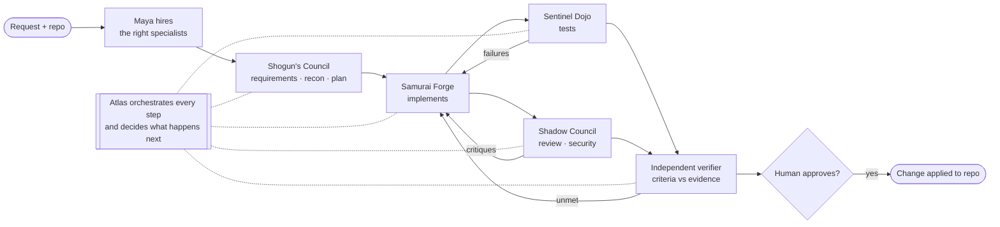
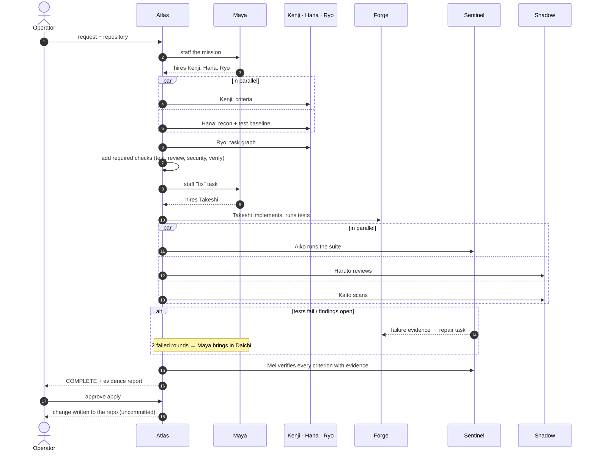
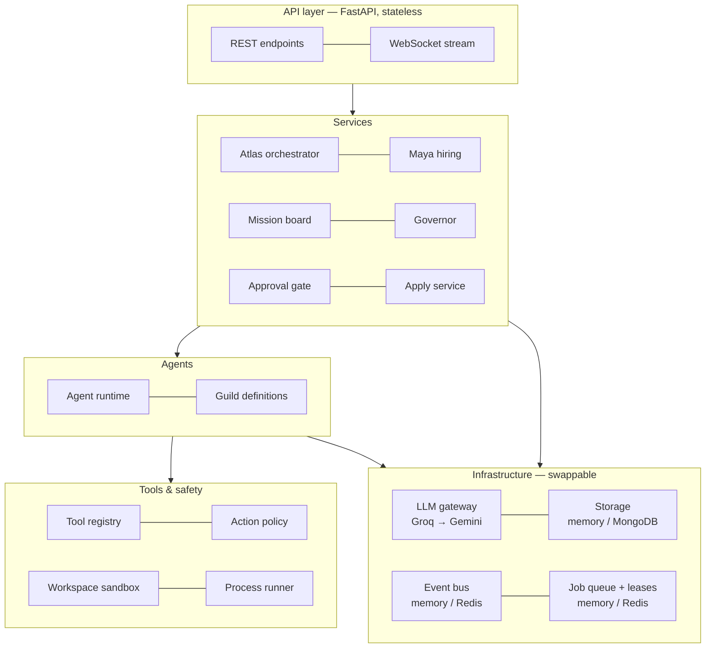

# DevPilot — Complete Project Context

> **PECathon 2026 · Problem Statement PS-001**
> *DevPilot: The Mystic Mikado's Autonomous AI Engineering Guild*
> *Plan like a Shogun. Build like a Samurai. Test like a Sentinel. Adapt until the mission is complete.*

This is the one-stop overview: the problem, what we built, how we built it, what makes it different, every team and agent, how a mission runs, and where the project stands. For the technical deep dive see [ARCHITECTURE.md](ARCHITECTURE.md).

---

## Contents

1. [The problem statement](#1-the-problem-statement)
2. [What we built — in one page](#2-what-we-built)
3. [Our USP — what makes DevPilot different](#3-our-usp)
4. [The guild: teams, agents and their tasks](#4-the-guild)
5. [How a mission runs](#5-how-a-mission-runs)
6. [How the system is built](#6-how-the-system-is-built)
7. [Safety and human oversight](#7-safety-and-human-oversight)
8. [How we meet every PS-001 requirement](#8-requirement-coverage)
9. [Evaluation: scenarios and the single-agent baseline](#9-evaluation)
10. [How we built it — the journey](#10-how-we-built-it)
11. [Results so far](#11-results-so-far)
12. [Technology stack](#12-technology-stack)
13. [Running it](#13-running-it)
14. [Repository map](#14-repository-map)
15. [Status, limitations and next steps](#15-status-and-next-steps)
16. [Glossary](#16-glossary)

---

## 1. The problem statement

### Background (PS-001)

When a decree arrives in the Emperor's kingdom, his engineering guild — strategists, builders, testers and guardians — must plan, build, verify and review the change, and adapt when things go wrong. **Build DevPilot, a multi-agent AI system that turns a natural-language software request into a working, tested and reviewed change to an existing small repository.**

### Tasks

**A) The Shogun's Council — Planning**
- **Requirement analysis:** convert the request into objectives and acceptance criteria.
- **Codebase reconnaissance:** inspect the project to find relevant files, conventions and risks.
- **Task decomposition and delegation:** break the mission into tasks, assign them to agents, and revise the plan when new information or blockers appear.
- **Shared mission state:** keep a common record of task status, findings, decisions and open issues across agents.

**B) The Samurai Forge — Implementation**
- **Tool selection:** developer agents choose among at least three tools (e.g. file read/search, file edit, terminal commands).
- **Context-aware development:** follow the project's existing style and structure rather than blindly generating new code.
- **Adaptive problem solving:** investigate unexpected errors and change approach when needed.
- **Controlled execution:** restrict commands and file access to the repo folder, and block destructive operations.

**C) The Sentinel Dojo — Testing and Verification**
- **Automated testing:** run the project's tests (or build/lint checks).
- **Failure investigation and repair:** analyse errors, send findings back to the developer agent, and rerun.
- **Independent verification:** a separate verifier agent or process checks the acceptance criteria.
- **Evidence-based completion:** record what changed, which checks passed or failed, and what remains unresolved. The system must not claim success without evidence.

**D) The Shadow Council — Review and Security**
- **Code review:** review the changes for correctness, readability, consistency and regressions.
- **Security inspection:** basic checks for exposed secrets, unsafe operations and injection risks.
- **Cross-agent critique:** reviewers can send findings back to developers; disagreements are settled by evidence or escalated to a human.
- **Human oversight:** require human approval before consequential actions such as merging or applying changes.

**E) The Living Campaign — Coordination and Adaptive Autonomy**
- **Inter-agent communication:** agents exchange findings and use each other's results. *Sequential LLM calls with different personas do not count.*
- **Feedback loops:** failures or review findings must trigger further investigation and revised actions.
- **Adaptive orchestration:** decide when to continue, retry, ask for clarification, or stop.
- **Bounded autonomy:** define success conditions, iteration limits, permissions and escalation rules; handle failed tools and repeated failures without endless loops.

The architecture, number of agents and division of responsibilities are up to the team. Any language, framework, model or agent framework is allowed; a local repository is enough. *"The goal is not to maximize the number of agents or tools, but to show that coordination and iterative reasoning contribute meaningfully to the result."*

### Evaluation scenarios (from the PS)

Test on small controlled repositories covering: **feature implementation**, **bug investigation**, **test-driven recovery** (a failing test), **security and code review** (a planted vulnerability), and **unexpected conditions** (an unavailable tool, an ambiguous requirement, or repeated test failures). Demonstrate at least one complete end-to-end mission and one feedback loop where new evidence changes what an agent does next.

### Evaluation criteria (from the PS)

Task completion · agent coordination · tool-calling intelligence · adaptability · code quality · testing and verification · security and reliability · transparency. *All reported results must come from actual test runs; clearly separate verified outcomes from assumptions and model claims.*

### Deliverables (from the PS)

Source code and a working demonstration; a multi-agent architecture with defined roles; a working implementation, testing and verification workflow; at least one end-to-end mission with a run log showing a feedback loop; setup instructions, configuration files and a list of supported tools; a README with an architecture diagram, communication/orchestration/shared-state design, setup, tools and execution boundaries, the human approval mechanism, security assumptions and known limitations.

**Bonus:** parallel or dynamically created agents · automatic reruns and self-correction when tests fail · persistent memory, or comparison against a single-agent baseline.

> *"It should not be a fixed pipeline of chatbots. Let the guild prove its worth not by the number of agents it commands, but by the quality of the software it delivers."*

---

## 2. What we built

**DevPilot is an AI engineering guild that takes a plain-language request and a repository, and returns a verified change — tested, reviewed, security-inspected and independently checked — that a human approves before it touches the real code.**



At a glance:

- **16 agents in 6 teams**, built on the hierarchy of our earlier project **Mycel**: **Atlas** orchestrates, **Maya** hires.
- **Maya hires dynamically** — only the specialists a mission needs, at the start *and* while it runs (e.g. a debugger when a fix keeps failing).
- **Atlas runs a decision loop, not a pipeline** — every decision recorded with its reason.
- **Agents coordinate through a shared mission board** — messages, findings, evidence, questions — using governed, audited tools.
- **Nothing is "done" without evidence** — real test runs, diffs and scans; criteria are only *met* with cited passing evidence.
- **Humans stay in control** — risky actions need approval, ambiguity pauses for an answer, and the real repository changes only after a human approves the diff.
- **Production-grade backend** — stateless API, scalable workers, MongoDB, Redis, crash recovery; also runs as a single process on a laptop.
- **Proven live** — complete missions run end to end on Groq with real agents, including on the full API + worker deployment.

---

## 3. Our USP

| # | What sets DevPilot apart | Why it matters |
|---|---|---|
| 1 | **Dynamic hiring by an HR agent (Maya)** — deterministic skill scoring with explainable scores, hiring at mission start *and mid-mission*, automatic escalation to a different specialist when work keeps failing | The guild shapes itself to each problem; a 16-agent organisation runs as a 4–8-agent task force when that is all the job needs. Directly answers the bonus for dynamically created agents. |
| 2 | **Evidence-gated completion** — results are stored records of real tool runs; a criterion cannot be marked met without passing evidence; the mission cannot complete otherwise | The system *cannot* claim success it has not proven — the PS's central demand. |
| 3 | **Mandatory quality gates** — whatever the planner proposes, Atlas adds testing, code review, security inspection and independent verification | Every change gets the full PS workflow; a weak plan can't skip safety. |
| 4 | **Real coordination, fully auditable** — agents message teams, hand off work, critique, dispute and ask questions through governed tools; an Arbiter settles disputes on evidence | Not "sequential LLM calls with personas": the coordination is visible, attributable and measurable. |
| 5 | **Feedback loops that change who does what** — failing tests → repair → re-test; findings → fix → re-review; two failures → the Debugger takes over; no test runner → a test author is hired | Demonstrates adaptability with evidence-driven decisions, not retries of the same thing. |
| 6 | **Safety by construction** — isolated workspace copy, no shell, path jail, secrets scrubbed, GREEN/AMBER/RED policy, separation of duties in tool grants, all-or-nothing apply with conflict detection and backups | Agents can be wrong without being dangerous. |
| 7 | **Bounded autonomy everywhere** — budgets, loop guard, attempt and repair limits, escalation to a human, outage handling | It never loops forever and never burns unbounded tokens. |
| 8 | **Production architecture** — API replicas + workers, job queue, per-mission leases, crash recovery, approvals that work across servers | Scales beyond a demo; built like a real service. |
| 9 | **Honest evaluation** — hidden acceptance checks the agents never see, a single-agent baseline, and reports that separate verified results from claims | Proves the multi-agent design earns its keep — the PS's own test of success. |
| 10 | **Hardened against real model behaviour** — every quirk found in live runs (token limits, hallucinated tools, malformed calls, context amnesia) is handled and regression-tested | It works with real, imperfect models — not just in scripted demos. |

---

## 4. The guild

Every agent has a **role**, **skills** (what Maya hires on — the first is its specialism), **tools** (what it is allowed to do) and a **result contract** (what it must hand back). Separation of duties is built into the tool grants: reviewers, the verifier, the security inspector and the arbiter **cannot edit code**.

### Executive — *E) The Living Campaign*

| Agent | Role | Tasks |
|---|---|---|
| **Atlas** | Mission Orchestrator (the Shogun) | Opens the mission; dispatches ready tasks in parallel; reads every result and decides — continue, retry, reassign, re-plan, clarify, escalate, stop, complete; enforces the quality gates; runs the feedback loops; completes the mission only on verified evidence; writes the report. Rule-based, so every decision is explained and reproducible. |
| **Maya** | Guild HR — Hiring Engine | Hires the planning council at start; staffs each task as the plan reaches it; excludes authors from reviewing their own work; brings in an escalation specialist when a task keeps failing; writes each hire's mandate; releases the task force at the end. |

### Planning — *A) The Shogun's Council*

| Agent | Role | Tasks | Hands back |
|---|---|---|---|
| **Kenji** | Requirements Analyst | Turns the request into objectives and 2–5 testable acceptance criteria grounded in the code; asks the human only when the request has two genuinely different readings | objectives, acceptance criteria, ambiguities |
| **Hana** | Codebase Scout | Maps the layout, key files and conventions; finds how tests run and records the baseline; shares findings and hands off to the Forge | test command, baseline, key files, conventions, risks |
| **Ryo** | Task Planner | Breaks the mission into a small task graph linked to the criteria, with dependencies so independent work runs in parallel | task graph |

### Forge — *B) The Samurai Forge*

| Agent | Role | Tasks |
|---|---|---|
| **Takeshi** | Backend Engineer | Implements backend/Python changes in the project's style; reproduces, fixes, re-runs tests; answers critiques (addressed, or disputed with evidence); hands off to the Sentinels |
| **Yuki** | Frontend Engineer | Implements JavaScript/TypeScript/UI changes in the existing patterns; avoids unsafe HTML |
| **Daichi** | Debugger (escalation specialist) | Called in when a fix keeps failing: reproduces, forms and tests hypotheses, fixes the root cause — never by weakening tests — and does something different from earlier attempts |
| **Sora** | Refactor & Style Keeper | Fixes quality and maintainability findings without changing behaviour; runs linters and tests before and after |

### Sentinel — *C) The Sentinel Dojo*

| Agent | Role | Tasks | Hands back |
|---|---|---|---|
| **Aiko** | Test Runner | Runs the suite (and lint/build); reports exactly what the run shows; records failures and sends them to the developer with evidence | passed, failing tests |
| **Riku** | Test Author | Writes tests that pin down criteria and regressions, in the project's test style; sets up a test runner when a project has none | — |
| **Mei** | Independent Verifier | Runs the checks herself, reads the diff, and records a verdict on every criterion — *met* only with passing evidence, otherwise *unmet* or *unverifiable* with what is missing | verdict per criterion |

### Shadow — *D) The Shadow Council*

| Agent | Role | Tasks | Hands back |
|---|---|---|---|
| **Haruto** | Code Reviewer | Reviews the diff and surrounding code for correctness, readability, consistency and regressions; records real problems and sends critiques | approved, findings |
| **Kaito** | Security Inspector | Runs secret and static scans, confirms or dismisses each hit, looks for injection, unsafe deserialisation, missing validation and exposed secrets | approved, findings |
| **Emi** | Arbiter | Settles developer-vs-reviewer disputes on evidence; rules for one side or escalates to a human | ruling |

### Support

| Agent | Role | Tasks |
|---|---|---|
| **Scribe** | Mission Scribe | Writes a narrative evidence report when the plan asks for one (Atlas always writes the authoritative, evidence-built report) |

### Tools available to the guild (21)

| Group | Tools |
|---|---|
| Files | `read_file`, `write_file`, `edit_file`, `list_dir`, `find_files` |
| Search | `search_text` |
| Commands | `run_command` (policy-checked), `run_tests` (auto-detects the runner; result stored as evidence) |
| Git | `git_status`, `git_diff` (evidence), `git_log` |
| Security | `secret_scan`, `static_scan` |
| Coordination (board) | `mission_state`, `read_inbox`, `send_message`, `record_finding`, `update_finding`, `raise_issue`, `list_evidence`, `verify_criterion` (Mei only) |

Common to all agents: the read tools, the coordination tools and the shared guild rules (act only through tools, follow the project's style, cite evidence, never repeat a failed call, finish once). Each agent adds its role-specific tools and instructions.

---

## 5. How a mission runs



**What the operator sees and does:** submits the request; watches the live log (who was hired and why, every tool call, every decision); answers questions if the request is ambiguous; approves or denies risky actions; reviews the final diff and approves applying it. Every step is in the event stream, the audit trail and the final report.

**Feedback loops in action:**

| Evidence | What happens next |
|---|---|
| Tests fail | A repair task carrying the real failure output goes to the developer; tests re-run |
| Two repair rounds fail | Maya hires the Debugger (Daichi) to take over |
| Review / security finding | Repair task; the reviewer re-checks |
| Developer disputes a finding | Emi rules on evidence — or a human decides |
| Criteria unmet or unprovable | Repair, or Riku writes the tests that prove them; Mei re-verifies |
| Code changed | Every check that already ran runs again |
| No test runner in the project | Riku sets one up and writes tests |
| Ambiguous request | Mission pauses; the human answers; it resumes with all work kept |
| Model unavailable / limits hit | Retry after a pause, then escalate to a human — never an endless loop |

---

## 6. How the system is built



| Component | What it does |
|---|---|
| **Mission board** | The shared mission state: objectives, criteria, task graph, findings, decisions, issues, hires, evidence and messages — with rules enforced in code and conflict-safe updates for agents working in parallel |
| **Agent runtime** | One loop for every agent: briefing → model → governed tool calls → evidence back → `finish`; fits every request within the model provider's token limit; keeps a memory digest when history is trimmed |
| **Governor** | The only path from an agent to a tool: budgets, loop guard, audit trail, evidence capture |
| **Tool registry + policy** | Checks the agent's grant, repairs near-miss arguments, classifies every action GREEN / AMBER / RED |
| **Sandbox** | Each mission works on an isolated git copy of the repository with a baseline commit |
| **Approval gate** | Human approval for AMBER actions; works across servers; no answer means no |
| **Apply service** | Writes the verified change to the real repo only after approval, all-or-nothing, with conflict detection and backups |
| **LLM gateway** | Model routing (smart/fast tiers), key-pool rotation and cooldowns, fallback providers, usage ledger |
| **Events & realtime** | Every change is an event: stored, sequenced, streamed live over WebSocket, and folded into a control-room snapshot |
| **Execution** | Inline (one process) or queue mode (API + workers) with leases and crash recovery |

Full detail: [ARCHITECTURE.md](ARCHITECTURE.md).

---

## 7. Safety and human oversight

- **Isolation:** agents never touch the user's repository; they work on a copy. Paths that escape it are refused.
- **No shell:** commands run as plain argument lists; pipes, chaining and redirection cannot be injected. Secret-looking environment variables are removed.
- **Action policy:**
  - **GREEN** (runs): reading, searching, tests, linters, builds, read-only git.
  - **AMBER** (human approval): installing packages, inline code (`python -c`), commits, reading `.env`/key files, CI changes, unknown commands.
  - **RED** (refused): shells, destructive and system commands, network tools, history-rewriting git, publishing.
- **Separation of duties:** reviewers and the verifier hold no write tools; authors cannot review or verify their own change.
- **Human oversight:** approval modal for AMBER actions; clarification questions pause the mission; applying to the real repository always requires approval, writes nothing on conflict, keeps backups, and never commits or pushes.
- **Bounded autonomy:** tool-call, token and time budgets; loop guard; attempt and repair limits; escalation to a human.
- **Access control:** sign-in with JWT; roles viewer < operator < approver < admin; every human action recorded under the user's name; rate limits on login and requests.
- **Transparency:** full event stream, audit trail of every tool call (with who approved it), decisions with reasons, and an evidence report that separates verified results from claims.

---

## 8. Requirement coverage

| PS-001 requirement | How DevPilot meets it |
|---|---|
| Requirement analysis | Kenji → objectives + testable acceptance criteria |
| Codebase reconnaissance | Hana → layout, conventions, risks, test baseline (shared as findings) |
| Task decomposition & delegation, revise the plan | Ryo's task graph; Maya staffs tasks; Atlas adds repair/test tasks when evidence demands (recorded as re-plan decisions) |
| Shared mission state | The mission board (status, findings, decisions, issues, evidence, messages) |
| Tool selection (≥3 tools) | 21 tools; developers choose among read, search, edit, write, run, test, git |
| Context-aware development | Recon findings and conventions in every briefing; rules to follow house style; reviewers check consistency |
| Adaptive problem solving | Errors fed back with explanations; loop guard forces a new approach; escalation to the Debugger |
| Controlled execution | Workspace jail, no shell, RED/AMBER/GREEN policy, destructive commands blocked |
| Automated testing | `run_tests` auto-detects the runner; every run stored as evidence |
| Failure investigation & repair | Failing evidence → repair task with the real output → re-test |
| Independent verification | Mei, who did not write the change and cannot edit code, verifies every criterion |
| Evidence-based completion | Criteria met only with passing evidence; mission completes only when all are met; evidence report |
| Code review | Haruto |
| Security inspection | Kaito with secret and static scans |
| Cross-agent critique, disputes | Critiques → repair; disputes → Emi on evidence → or a human |
| Human approval before applying | AMBER apply approval with diff review, conflict detection, backups |
| Inter-agent communication | Messages, findings, handoffs, critiques and questions through governed board tools |
| Feedback loops | Test, review, verification and dispute loops; code changes re-run stale checks |
| Adaptive orchestration | Atlas decides continue / retry / reassign / re-plan / clarify / escalate / stop / complete |
| Bounded autonomy | Budgets, loop guard, attempt and repair limits, outage handling, escalation rules |
| **Bonus:** parallel / dynamic agents | Up to 3 agents in parallel; Maya hires at runtime and escalates to specialists |
| **Bonus:** automatic reruns & self-correction | Repair → re-test loops; stale checks re-run after any change |
| **Bonus:** single-agent baseline | Evaluation harness runs the same scenarios with one agent for comparison |
| Bonus: persistent memory | Not yet (planned) |

---

## 9. Evaluation

Six small repositories in [`missions/`](../missions), one per PS scenario. Each has **hidden acceptance checks** the agents never see, and a reference solution proving the checks are correct.

| Scenario | PS case | What is planted |
|---|---|---|
| `01-feature-discounts` | Feature implementation | Add discount codes without changing existing behaviour |
| `02-bug-pagination` | Bug investigation | Off-by-one repeating products across pages — the existing tests do *not* catch it |
| `03-failing-test-durations` | Test-driven recovery | Minutes parsed as hours; CI is red; tests must not be weakened |
| `04-vulnerability-accounts` | Security & code review | SQL injection via an f-string + a hard-coded API token |
| `05-ambiguous-export` | Ambiguous requirement | "Make the export better" — the hidden checks encode the human's answer, so guessing fails |
| `06-no-tests-temperature` | Unavailable tool | A conversion bug in a project with no test runner at all |

The harness runs each scenario with **the guild** and with a **single-agent baseline** (same model, runtime, tools and safety — but no planning, review, verification or human). A run counts as a **verified success** only when the system claims success *and* the hidden checks pass. Each run exports a JSON and Markdown run log.

---

## 10. How we built it

**Starting points.**
- **Mycel**, our earlier multi-agent project: 22 agents in a hierarchy with Atlas and Maya, a pixel-art control room, and a Groq-based backend.
- **Jarvis**: a desktop AI assistant with a mature tool registry and safety policy.

We kept Mycel's organisation and Jarvis's tool discipline, and rebuilt the rest for software engineering. Code was ported and adapted into a new backend (`backend_main/`), never imported at runtime.

**Phase by phase:**

| Phase | Built |
|---|---|
| 0 Foundation | Typed settings, logging, error model, app factory, dependency container, health checks, Docker |
| 1 Infrastructure | LLM gateway with key pools, event bus, event store, WebSocket stream |
| 2 Tools & sandbox | Isolated workspaces, action policy, tool registry, 13 engineering tools |
| 3 Governance | Approval gate, budgets, loop guard, audit trail |
| 4 Mission core | Mission board, task graph, evidence, agent messages, snapshot |
| 5 Agent runtime | Tool-calling loop, finish contract, board tools for communication |
| 6 Guild & hiring | 16 agent definitions, Maya's deterministic hiring and escalation |
| 7 Atlas | The orchestration loop, feedback loops, gates, evidence report |
| 8 Scale & apply | Job queue, leases, workers, crash recovery, human-approved apply |
| 9 Evaluation | Six scenario repos with hidden checks, harness, single-agent baseline |
| 10 Hardening | JWT auth with roles, per-user attribution, rate limits, security headers, metrics, production guards, submission README |

**Tested against reality, not just mocks.** Every phase has automated tests, and from Phase 5 on we ran real agents on Groq after each change. Live runs exposed problems no scripted test would — and each fix has a regression test:

- Groq's free tier rejects any request over **8,000 tokens**, which surfaced as "model unavailable" → agents now budget every request (compact tool schemas, capped output, trimmed history).
- The model calls **tools that don't exist** (`json`, `commentary`, `repo_browser.list_dir`), sends `null` arguments, and writes its "finish" as text → all handled.
- With trimmed history, agents **forgot their own work** and repeated it → a per-run memory digest and a step-limit warning.
- Rate-limit bursts looked like outages; a retired model silently disabled features; Windows line-ending settings would have broken applying changes; the loop guard blocked a legitimate re-test after a fix; escalation counted re-runs as failures → all fixed.

---

## 11. Results so far

| Result | Detail |
|---|---|
| Automated tests | **176** (170 without external servers; MongoDB and Redis backends verified against real servers) |
| First live end-to-end mission | **Completed in 88 s** — 8 hired specialists plus Atlas and Maya, 58 governed tool calls, all 5 criteria verified with evidence; run log in [`runs/2026-10-30-live-billing-fix/`](runs/2026-10-30-live-billing-fix/report.md) |
| Production deployment, live | API (queue mode) + separate worker on MongoDB + Redis: **completed in 82 s**, applied to the repository only after human approval |
| Feedback loops | Demonstrated in automated whole-mission scenarios (failing tests → repair → escalation to the Debugger; review dispute → arbitration; clarification → resume; missing test runner → test author) |
| Evaluation | Scenario set and harness complete and tested; the full live guild-vs-baseline run is the next step |

---

## 12. Technology stack

| Area | Choice |
|---|---|
| Language / runtime | Python 3.12+, asyncio |
| API | FastAPI, Uvicorn, WebSockets, Pydantic v2 |
| Models | Groq `openai/gpt-oss-120b` (agents), `openai/gpt-oss-20b` (mandates); Gemini fallback; any OpenAI-compatible endpoint |
| Storage | MongoDB (Motor) or in-memory |
| Messaging | Redis pub/sub (events), Redis Streams (jobs), Redis keys (leases) — or in-memory |
| Sandbox | Git (workspace baselines and diffs), subprocess without a shell |
| Deployment | Docker, docker-compose (API + scalable workers + MongoDB + Redis) |
| Frontend | Mycel's Next.js 16 / React 19 control room with pixel-art office (to be adapted) |
| Testing | pytest, pytest-asyncio, httpx mock transports, scripted model providers |

---

## 13. Running it

```bash
cd backend_main
pip install -r requirements-dev.txt
cp .env.example .env          # set GROQ_API_KEYS=key1,key2,...
python -m uvicorn app.main:app --port 8000
```

Open **http://localhost:8000/docs** and `POST /api/v1/missions` with `{"request": "...", "repo_path": "...", "start": true}`. Follow it with `GET /missions/{id}/snapshot` or the WebSocket `/api/v1/realtime/missions/{id}`; answer questions, approve actions, review `GET /missions/{id}/patch`, then `POST /missions/{id}/apply`.

Production-style: `docker compose up --build --scale worker=3`. Evaluation: `python -m app.evaluation --mode both --out ../docs/runs/my-eval`.

Model throughput: on Groq's free tier, limits are per account (~8,000 tokens per minute and per request); around 15–20 keys from separate accounts give ~1.5-minute missions. Python 3.12 recommended.

---

## 14. Repository map

| Path | Contents |
|---|---|
| [`backend_main/`](../backend_main) | **DevPilot backend** (the product) |
| [`missions/`](../missions) | Evaluation scenarios with hidden checks |
| [`docs/ARCHITECTURE.md`](ARCHITECTURE.md) | Detailed technical architecture |
| [`docs/BACKEND_PHASES.md`](BACKEND_PHASES.md) | Build phases and status |
| [`docs/runs/`](runs) | Live run logs and reports |
| [`frontend/`](../frontend) | Mycel control-room frontend (to be adapted) |
| [`backend/`](../backend) | Mycel backend (source of ported code; not used at runtime) |
| [`jarvis/`](../jarvis) | Jarvis (source of ported tools and safety policy; not used at runtime) |

---

## 15. Status and next steps

**Done:** backend phases 0–10 — the full guild, orchestration, governance, safety, scaling, apply flow, evaluation harness, and hardening (JWT auth with roles, rate limits, security headers, metrics, production guards), with live end-to-end missions.

**Next:**

| Priority | Item |
|---|---|
| 1 | Run the full live evaluation (6 scenarios × guild and baseline) and publish the comparison |
| 2 | Frontend: mission intake (repo + request), live pixel office, task board, answer box, approval modal, diff review and "apply" |
| 3 | Root README for submission (architecture diagram, setup, tools, boundaries, approvals, assumptions, limitations) |
| 5 | Guild → team → agent layering for tools and skill packs, guided by evaluation results |
| 6 | Bonus features: persistent memory across missions; on-demand tool loading to save tokens |

**Known limitations:** frontend not yet adapted; process-level sandbox (not a container per mission); stopping is cooperative (a running test finishes first); workers need each project's toolchain; Gemini fallback not verified live.

---

## 16. Glossary

| Term | Meaning |
|---|---|
| **Mission** | One request against one repository, from analysis to verified change |
| **Workspace** | The isolated git copy of the repository a mission works on |
| **Baseline** | The workspace's first commit; every diff is against it, and applying checks the real repo still matches it |
| **Task graph** | The mission's tasks and their dependencies; ready tasks run in parallel |
| **Gate** | A check Atlas guarantees in every plan: test, review, security, verify |
| **Repair task** | Work Atlas sends back when evidence shows a problem |
| **Evidence** | A stored record of a real tool run (test run, diff, scan) with its verdict |
| **Criterion** | A testable acceptance condition; *met* only with cited passing evidence |
| **Finding** | A fact or problem recorded on the board by an agent |
| **Issue** | A question, blocker or dispute; `needs_human` ones pause the mission |
| **GREEN / AMBER / RED** | Runs freely / needs human approval / refused |
| **Governor** | Enforces budgets, the loop guard and the audit trail on every tool call |
| **Mandate** | The one-line brief Maya gives each hire for this mission |
| **Verified success** | The system claims success *and* hidden acceptance checks pass |
